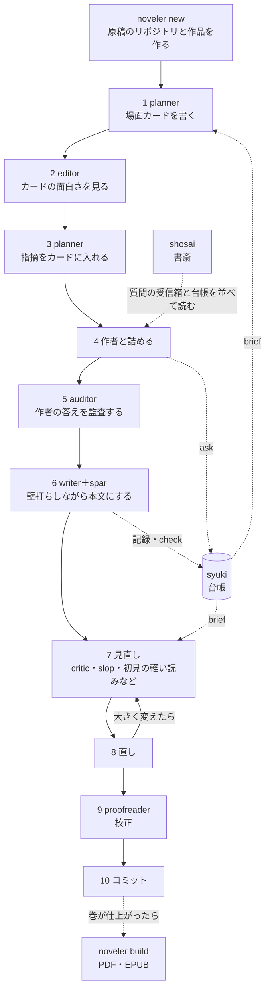
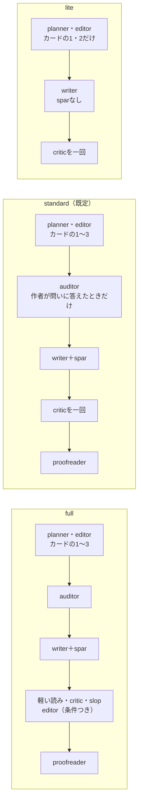

# agent-noveler

Tools for writing Japanese novels with AI agents: **syuki** (a CLI that keeps a story ledger and checks manuscripts against it), **shosai** (a vertical-text viewer for red-pen review and typesetting), and an **agent harness** (role definitions, rules and skills for Claude Code, Codex, pi, OpenCode and Antigravity). Genre-specific know-how lives in swappable style packs; the first one is for light novels.

---

AIと一緒に日本語の小説を書くための道具一式です。原稿そのものは入っていません。試すための短い見本作品だけを同梱しています。

| フォルダ | 中身 | ライセンス |
| --- | --- | --- |
| `packages/syuki/` | 台帳CLI。人物が何を知っているか、持ち物がどこにあるかなどをYAMLの台帳に記録し、場面ごとの引き出しや、本文と照らした矛盾の検出に使う | MIT |
| `packages/shosai/` | 書斎ビューア。縦書きでの通読、赤入れ、組版の見た目の確認。syukiの台帳も横に表示 | AGPL-3.0 |
| `harness/` | エージェントの道具。役（書く、校正する、批評するなど）の手順書、決まり、スキル、役ごとの担い手を決める仕組み、文体パック | MIT |
| `examples/sample-work/` | 見本作品「灯台の鍵」（序章と第一章）。syukiとshosaiをそのまま試せる | MIT |

## 一章を書く流れ

役を分けたエージェントが、カードを作り、書き、見直して、一章を仕上げます。下の図は、全部の段を回す`full`の流れです。点線は、台帳（syuki）と書斎（shosai）を使う所です。



`noveler new --flow`で、回す段を減らせます。既定は`standard`です。



- 初見読みは、`full`では章ごとと巻、`standard`では巻のときだけ回します。`lite`では回しません。
- `lite`で省いた段は、`syuki lint`と`syuki check`で代えます。
- 各段の手順は[harness/AGENTS.md](harness/AGENTS.md)にあります。

## 入れ方

先に[git](https://git-scm.com/downloads)、[uv](https://docs.astral.sh/uv/)、[Node.js](https://nodejs.org/) 22以上を入れておきます。次の一行で、`noveler`コマンドとsyukiが入ります。

```sh
curl -fsSL https://raw.githubusercontent.com/narusenia/agent-noveler/main/install.sh | bash
```

途中で、Node.jsなどの道具を[mise](https://mise.jdx.dev)で管理するかを聞かれます。使っていなければ`plain`を選びます。

shosaiとsyukiを別々に入れるときは、[packages/shosai/README.md](packages/shosai/README.md)と[packages/syuki/README.md](packages/syuki/README.md)を見てください。

## 使い方

```sh
noveler new ~/novels      # 原稿のリポジトリと、最初の作品を作る
cd ~/novels
noveler open              # 書斎で開く
noveler build             # PDF に書き出す
```

本文は`<作品>/manuscript/<巻>/<章>.kym.txt`に書きます。

| コマンド | すること |
| --- | --- |
| `noveler new [フォルダ]` | 原稿のリポジトリと最初の作品を作ります。文体パックと書き方を聞かれます。書き方は`ai`（AIが書き、自分が見る）か`human`（自分が書き、AIが見る） |
| `noveler new --layout single\|packages` | 作品の置き場所を選びます。`single`（既定。リポジトリの直下）か`packages`（`packages/<作品>/`。一つのリポジトリで複数の作品を書くとき） |
| `noveler new --flow full\|standard\|lite` | 一章ごとの見直しの量を選びます。`standard`（既定）、`full`（全部の段）、`lite`（最少） |
| `noveler add [作品]` | 作品を足します。題と作者名を聞かれます |
| `noveler open [フォルダ]` | 作品を書斎（shosai）で開きます |
| `noveler build [作品] [巻]` | PDFに書き出します（`--epub`でEPUB） |
| `noveler update` | novelerとsyuki、ハーネスを最新にします |
| `noveler doctor` | 入っている道具と、`syuki check`の結果を表示します |
| `noveler help` | コマンドの一覧を表示します |

`-y`（`--yes`）を付けると、聞かずに既定値で進みます。

## ハーネスの効き目（before / after）

見本作品の第二章を、同じモデル（Gemini）に二通りに書かせました。beforeは資料とあらすじを渡して一度で書かせたもの、afterは上の流れを通したものです。どちらがafterかを伏せて、初見の読者二人（Claude）に読ませました。

| | before | after |
| --- | --- | --- |
| 続きを読みたい度（1〜5、二人の平均） | 3.0 | 4.0 |
| 第一章からのつながり（1〜5） | 3.0 | 4.5 |
| 読み続けたい版に選んだ人数 | 0 | 2 |
| 文長のばらつき（目安0.45以上） | 0.37 | 0.50 |
| 語り手の声がある地の文（目安30%以上） | 9% | 30%以上 |

**1. 主人公が、十年だれにも信じてもらえなかった「白い船を見た」話を打ち明ける**

before — 気持ちを地の文で説明しています。

> 「はい。灯台の下から、白い船を」
>
> 　言った瞬間、また笑われるかもしれないと思った。小学生のころに味わった居心地の悪さがよみがえる。けれど、おばあちゃんは笑わなかった。

after — 説明せず、時間と体の感覚で見せています。

> 「……拾って三日あとの霧の朝に、白い船を見ました。灯台の下を通っていくのを」
>
> 　言ってしまった。ハルの顔が見られず、視線を自分の手元に落とす。一秒、二秒。鍵の角が手のひらに食いこむ。笑うなら今だ。「またまた」とか「見間違いだろ」とか、そういう声が飛んでくるはずなのに。

**2. 章の最後の一文**

before — 「何かが動く気がした」という決まった言い方で閉じています。

> 　少しだけ照れたように目をそらすハルを見て、俺はポケットの中の鍵をもう一度握り直した。三日後、あの霧の中で、今度こそ何かが動く気がした。

after — 物の手触りと、すぐには答えられない迷いで閉じています。

> 　三日後は平日だ。また朝から学校を抜けて岬へ向かうのか。背中の鞄の底で、白紙のまま折った進路の紙がかさりと鳴った気がして、俺はすぐには返事ができなかった。

一章を一回比べただけで、読者と批評役はClaudeです。手間もafterのほうがずっと多くかかっています。条件、全文、各段の報告、読者の答えは[docs/showcase/](docs/showcase/README.md)にあります。

## 見本で試す

このリポジトリを手元に置けば、見本作品で書斎とsyukiを試せます。必要なもの: [uv](https://docs.astral.sh/uv/)、Node.js 22、pnpm 11。

```sh
git clone https://github.com/narusenia/agent-noveler
cd agent-noveler
pnpm install
pnpm review        # 書斎が http://localhost:13002 で開き、見本作品が本棚に並ぶ
pnpm syuki check --work examples/sample-work   # 台帳と本文を照らす（違反 0 件）
```

PDFとEPUBは[Vivliostyle](https://vivliostyle.org/ja/)で組みます。書斎の組版と同じ`book.config.js`を読むので、画面で確かめた組みがそのままPDFになります。

```sh
cd examples/sample-work
pnpm build                  # sample-work_vol1.pdf
pnpm build:epub             # sample-work_vol1.epub
VOL=vol2 pnpm build         # 巻を選ぶ（既定は vol1）
```

## エージェントの道具（harness）

`noveler new`で作った原稿のリポジトリには入っています。novelerを使わずに入れるときは、このリポジトリから次のように実行します。各ツール（Claude Code、Codex、pi、OpenCode、Antigravity）が読む場所は[harness/README.md](harness/README.md)にあります。

```sh
bash harness/scripts/install.sh ~/novels [文体パック]   # 文体パックを省くと general
```

- 役ごとに誰に頼むか（Claudeのサブエージェント、herdrのペインのagy、OpenCodeなど）とモデルは、`.agents/roles.toml`で決めます。既定はすべてClaude Codeのサブエージェントです。
- `agy -p`（printモード）は、ほかのエージェントやスクリプトから呼ぶと利用規約に触れることがあります。既定では、どの道具も呼びません。規約を自分で確かめたうえで使う場合だけ、`roles.toml`の`[agy] allow_print`を`true`にしてください。
- 添削モード: `roles.toml`の`[mode] write`を`"human"`にすると、本文を書く役（writer・planner）は使われず、見る役は本文を書き換えません。校正の直しは書斎の指摘ファイルに赤として積まれるので、書斎で一つずつ採るか決め、「適用」で本文に入れます。
- 文体パック: ジャンルに固有の書き方と見方は文体パックに分けてあります。既定の**general**（ジャンルを問わない最小のもの）と、**light-novel**（ライトノベル・Web小説向け）があります。中身と作り方は[harness/packs/README.md](harness/packs/README.md)にあります。

## 参考資料

light-novelパックは、ライトノベルの文体研究と、LLMの文章の癖についての研究をもとに作りました。論文と資料の一覧は[research.md](harness/packs/light-novel/docs/research.md)と[sources.md](harness/packs/light-novel/skills/light-novel/references/sources.md)、参考にしたリポジトリとそのライセンスは[NOTICE](harness/packs/light-novel/skills/light-novel/NOTICE)にあります。

## ライセンス

パッケージごとに違います。詳しくは各フォルダの`LICENSE`を見てください。

- `packages/shosai/`はAGPL-3.0です。組版に使っている`@vivliostyle/core`がAGPL-3.0だからです。
- それ以外（`packages/syuki/`、`harness/`、`examples/`）はMITです。
